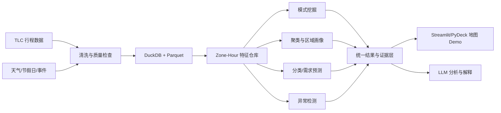

# UrbanPulse PRD

## 1. 项目概述

UrbanPulse 是一个城市出行模式、需求预测与异常检测平台。项目基于公开出租车数据，回答三个核心问题：

1. 城市出行呈现哪些稳定模式？
2. 能否预测区域的短期出行需求？
3. 哪些区域和时段发生了异常，原因可能是什么？

项目采用“边学边做”的方式持续迭代，学期末交付可交互、可解释、可复现的完整 Demo。

当前落地：v0.1「第一课数据实验室」，包含质量体检、清洗对比、描述统计和可复现数据管道。运行方式见 [README.md](README.md)，练习见 [docs/LESSON1.md](docs/LESSON1.md)。

## 2. 数据范围

- 主数据：[NYC TLC 出租车行程数据](https://www.nyc.gov/site/tlc/about/tlc-trip-record-data.page)
- 基础范围：一个月 Yellow Taxi 数据，用于快速完成 MVP
- 最终范围：固定年度或多月数据快照
- 分析粒度：`出租车区域 × 小时`
- 可选数据：天气、节假日及城市事件

## 3. 核心功能

### P0：学期末必须完成

- 数据清洗、质量检查和特征工程
- 区域出行画像与聚类
- 下一时段高需求分类或需求量预测
- 区域—小时异常检测与异常排名
- 关联规则或典型出行模式发现
- 交互式地图与时间筛选
- 基于真实分析结果的 LLM 异常解释
- 基线对比、模型评估和实验记录

### P1：拓展功能

- 接入天气和事件数据
- LSTM/Transformer 时序预测
- OD 出行网络与图模型
- 流式异常检测
- 跨城市或跨年份迁移分析

## 4. 系统架构

## 5. 技术方案

- 数据处理：Python、DuckDB、Parquet、Pandas/Polars
- 数据挖掘：scikit-learn、mlxtend、XGBoost
- 深度学习：PyTorch（拓展阶段）
- 可视化：Streamlit、PyDeck
- 实验管理：MLflow（可选）

LLM 只负责调用已有分析结果并生成解释，不直接计算指标或虚构结论。

## 6. 迭代里程碑

1. 数据管道：下载、清洗、质量报告和特征表
2. 模式挖掘：关联规则与典型出行模式
3. 监督学习：基线、分类/预测及严格的时间切分
4. 聚类分析：区域画像、算法比较与聚类评价
5. 异常检测：多方法比较、异常排名与案例分析
6. 产品化：交互地图、模型解释和 LLM 问答
7. 最终交付：实验复现、演示脚本、报告和展示

## 7. 验收标准

- 原始数据可通过脚本重复生成最终特征表
- 至少比较一种简单基线和两种数据挖掘方法
- 分类/预测使用时间切分，避免未来信息泄漏
- 聚类和异常检测均有量化评价及典型案例
- 地图能够按时间、区域和模型展示结果
- LLM 回答包含具体指标和数据依据，不确定时明确说明
- 新增月份、算法或外部数据时无需重写整体架构

## 8. 最终 Demo 流程

1. 选择日期和时间，查看各区域需求与异常等级
2. 点击区域，查看画像、预测、异常分数和历史基线
3. 切换算法，比较结果与评价指标
4. 向 LLM 询问异常原因，生成有数据依据的解释
