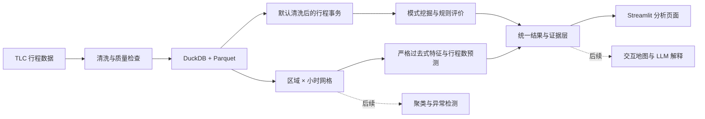

# UrbanPulse PRD

## 1. 项目概述

UrbanPulse 是一个城市出行模式、需求预测与异常检测平台。项目基于公开出租车数据，回答三个核心问题：

1. 城市出行呈现哪些稳定模式？
2. 能否预测区域的短期出行需求？
3. 哪些区域和时段发生了异常，原因可能是什么？

项目采用“边学边做”的方式持续迭代，学期末交付可交互、可解释、可复现的完整 Demo。

当前落地：v0.3.1「规则评价与证据」。在 v0.3 的区域小时监督学习上，新增双向置信度、Kulc、IR、完整列联表和独立事务计数核对；规则按 A/B 关系折叠、分页，并可导出全部匹配方向。新快照保存挖掘范围内的全部方向规则，旧快照明确提示预过滤边界。运行方式见 [README.md](README.md)，练习见 `docs/LESSON1.md` 至 `docs/LESSON3.md`，优化路线见 [L3/L4 规划](docs/L3_L4_OPTIMIZATION_ROADMAP.md)。

## 2. 数据范围

- 主数据：[NYC TLC 出租车行程数据](https://www.nyc.gov/site/tlc/about/tlc-trip-record-data.page)
- 基础范围：一个月 Yellow Taxi 数据，用于快速完成 MVP
- 最终范围：固定年度或多月数据快照
- 分析粒度：行程事务用于关联模式，`出租车区域 × 小时` 用于预测及后续区域分析
- 可选数据：天气、节假日及城市事件

## 3. 核心功能

### P0：学期末目标及当前进度

- 已完成：数据清洗、质量检查、行程事务与区域小时特征。
- 已完成：下一小时已记录行程数预测、时间切分、基线比较与误差证据。
- 已完成：Apriori/FP-Growth 关联模式、规则评价与独立计数核对。
- 已完成：交互式时间/区域筛选、快照与实验配置记录。
- 待完成：区域画像与聚类、区域小时异常检测与异常排名。
- 待完成：交互式地图、基于真实分析结果的 LLM 异常解释。
- 待完成：跨月份验证及最终综合实验报告。

### P1：拓展功能

- 接入天气和事件数据
- LSTM/Transformer 时序预测
- OD 出行网络与图模型
- 流式异常检测
- 跨城市或跨年份迁移分析

## 4. 当前架构与后续入口

## 5. 技术方案

- 当前数据处理：Python 3.12、DuckDB、Parquet、Pandas、NumPy。
- 当前模式挖掘：项目内实现的带权 Apriori 与 FP-Growth。
- 当前预测：scikit-learn 的 Poisson 梯度提升，joblib 保存模型。
- 当前展示与验证：Streamlit、Plotly、pytest；JSON/Parquet 记录配置、版本和指标。
- 后续按需求评估地图、外部数据、深度学习和实验管理工具；未使用的工具不列为当前依赖。

未来接入 LLM 时，只调用已有分析结果并生成解释，不直接计算指标或虚构结论。

## 6. 迭代里程碑

1. 已完成 v0.1 数据管道：下载、清洗、质量报告和特征表。
2. 已完成 v0.2 模式挖掘：关联规则与典型出行模式。
3. 已完成 v0.3 监督学习：基线、行程数预测及严格的时间切分。
   - 模式优化：v0.3.1 评价与证据已落地；后续约束与分层、压缩与实验按 L3/L4 路线推进。
4. 聚类分析：区域画像、算法比较与聚类评价
5. 异常检测：多方法比较、异常排名与案例分析
6. 产品化：交互地图、模型解释和 LLM 问答
7. 最终交付：实验复现、演示脚本、报告和展示

## 7. 验收标准

- 原始数据可通过脚本重复生成最终特征表
- 至少比较一种简单基线和两种数据挖掘方法
- 分类/预测使用时间切分，避免未来信息泄漏
- 聚类和异常检测均有量化评价及典型案例
- 地图能够按时间、区域和模型展示结果
- LLM 回答包含具体指标和数据依据，不确定时明确说明
- 新增月份、算法或外部数据时无需重写整体架构

## 8. 最终 Demo 流程

1. 选择日期和时间，查看各区域需求与异常等级
2. 点击区域，查看画像、预测、异常分数和历史基线
3. 切换算法，比较结果与评价指标
4. 向 LLM 询问异常原因，生成有数据依据的解释
